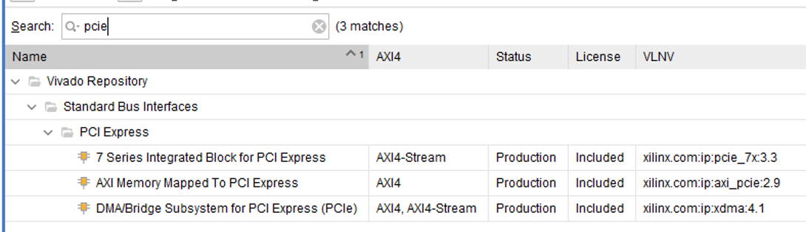
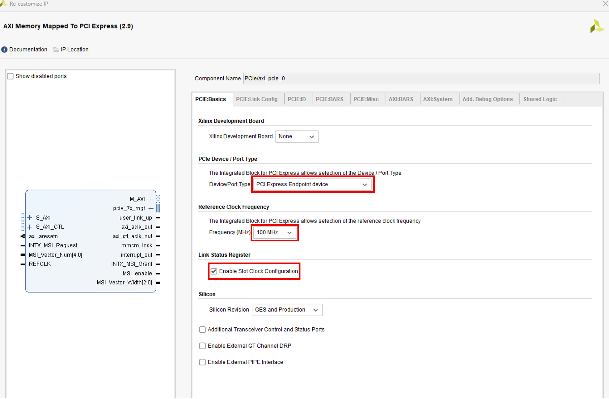
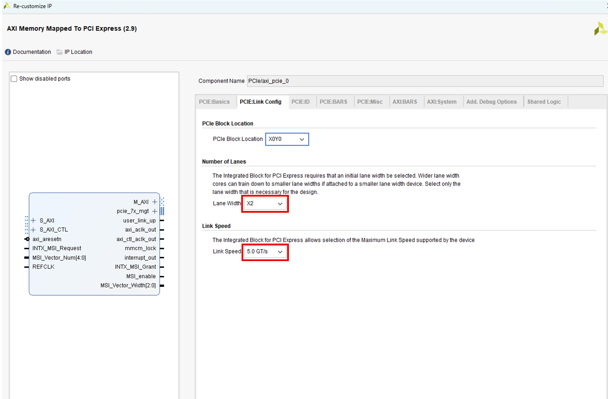
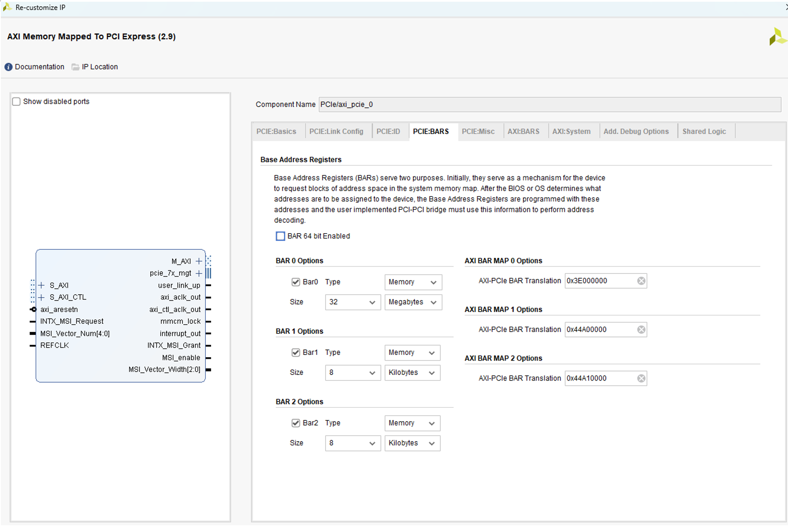
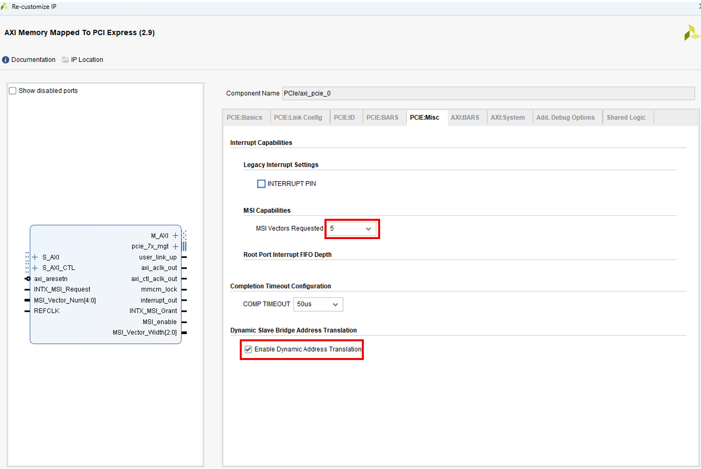
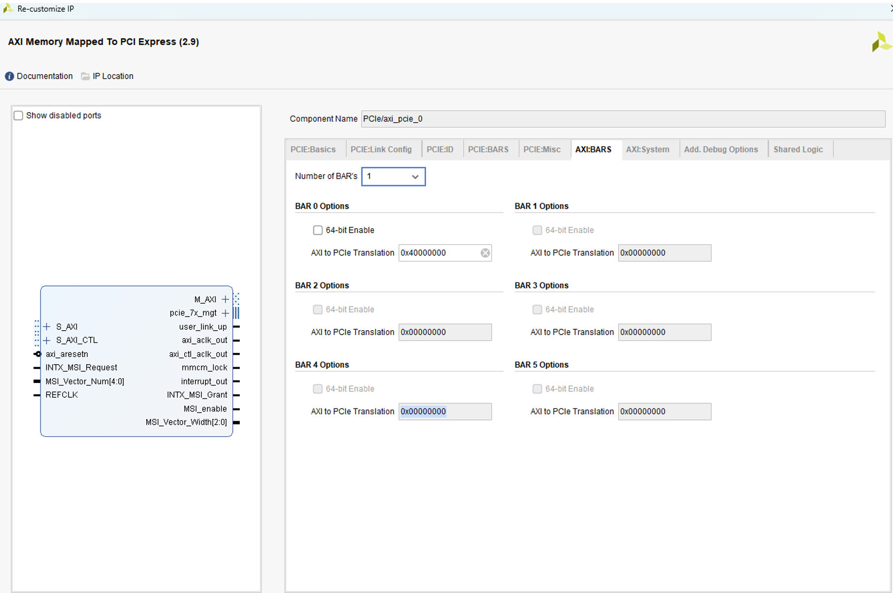
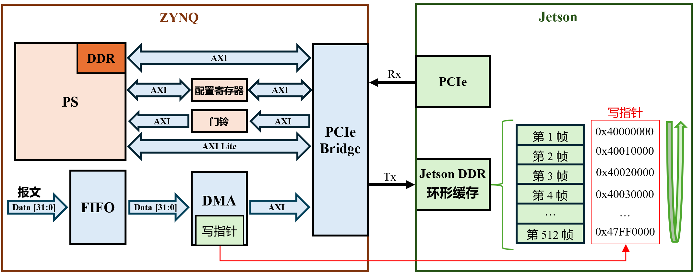

# Xilinx AXI Memory Mapped To PCIe 配置与通信流程

本文以 Zynq 与 Jetson 之间的 PCIe 通信为例，介绍 **AXI Memory Mapped To PCI Express 2.9** 的常用配置、双向地址映射，以及自定义 DMA 搬运数据的流程。Jetson 作为主机，Zynq 的 PL 侧作为 PCIe Endpoint；PS 负责控制，PL 负责报文传输。

文中的地址来自配置截图或明确标注的换算示例，移植时需要根据 FPGA 地址规划及 Jetson 驱动实际建立的 DMA 映射进行调整。

## 1 PCIe IP 的选择

Vivado 中常见的 PCIe IP 如下图所示。

<p align="center">
  <a href="./Images/PCIe_IP_Catalog.png"></a>
</p>

三者主要区别在于用户接口和功能封装层次。

| IP | 用户接口 | 主要功能与用户需要完成的工作 |
| --- | --- | --- |
| 7 Series Integrated Block for PCI Express | TLP 级 AXI-Stream | 提供 PCIe 控制器接口，用户实现业务 TLP 的组包、解析及数据搬运控制。 |
| AXI Memory Mapped To PCI Express | AXI Memory-Mapped | 将 AXI 读写事务转换为 PCIe TLP，并将收到的 PCIe 请求转换为 AXI 事务；用户负责数据源和搬运控制。 |
| DMA/Bridge Subsystem for PCI Express（XDMA） | AXI-MM 或 AXI-Stream，取决于配置 | 集成描述符驱动的 DMA 引擎，提供主机与 FPGA 之间的数据搬运功能。 |

本项目采用 **AXI Memory Mapped To PCI Express 与自定义 DMA** 的组合。PCIe 桥负责 AXI 与 TLP 的转换，PL 负责发送时机、目标地址、通道调度和环形缓存写指针管理，便于按采集业务组织数据通路。

这里选择自定义 DMA，是为了控制搬运逻辑，并不是因为 XDMA 必须经过 FPGA 外部 DDR。XDMA 也支持 AXI-Stream 数据通路。相关接口与功能可参考 [PG055](https://docs.amd.com/r/en-US/pg055-axi-bridge-pcie/Overview) 和 [PG195](https://docs.amd.com/r/en-US/pg195-pcie-dma/Introduction)。

## 2 PCIe IP 的主要配置

### 2.1 PCIe Basics

<p align="center">
  <a href="./Images/PCIe_Basics.png"></a>
</p>

- **Device/Port Type**：设置 PCIe 核的角色。本项目由 Jetson 作为主机，FPGA 作为采集设备，因此选择 `PCI Express Endpoint device`，由 Jetson 对其进行枚举和配置。
- **Reference Clock Frequency**：设置输入 PCIe 核的参考时钟频率，必须与板上实际提供的时钟一致。图中配置为 `100 MHz`，它不是 AXI 接口的工作频率。
- **Enable Slot Clock Configuration**：表示 PCIe 链路采用同源参考时钟。若 Jetson 向 FPGA 提供的参考时钟与链路另一端同源，应勾选此项。

### 2.2 PCIe Link Config

<p align="center">
  <a href="./Images/PCIe_Link_Config.png"></a>
</p>

- **Lane Width**：设置 PCIe 链路的通道数量。图中选择 `×2`，即使用两条 Lane，每条 Lane 包含一对发送差分线和一对接收差分线。配置应与实际硬件布线匹配，最终链路宽度由双方训练协商确定。
- **Link Speed**：设置设备支持的最高 PCIe 链路速率。图中选择 `5.0 GT/s`，对应 PCIe Gen2，表示每条 Lane 的传输速率，不是 AXI 时钟频率，也不是 `5 GB/s`。

当链路实际工作在 **PCIe Gen2 ×2** 时，扣除 8b/10b 编码开销后的单向理论带宽为：

```text
5.0 GT/s × 2 × (8/10) ÷ 8 = 1 GB/s = 1000 MB/s
```

这个数值尚未扣除 TLP 包头、CRC、链路管理等开销。对于大块连续 DMA 写入、数据供给充足且无明显背压的场景，可将 **700～900 MB/s** 作为粗略经验估算；它不是本工程的实测结果，也不是 IP 保证的吞吐率。实际数值仍需结合有效载荷大小、AXI 通路和 Jetson 端内存访问情况测量。

### 2.3 PCIe BARS

这一页配置的是 **Jetson 访问 FPGA 的入站窗口**。

<p align="center">
  <a href="./Images/PCIe_BARs.png"></a>
</p>

- **BAR 64 bit Enabled**：是否启用 64 位 BAR。本项目未勾选，使用 32 位 BAR，并非该 IP 只能使用 32 位 BAR。
- **Bar0 / Bar1 / Bar2**：启用对应的 BAR 窗口。
- **Type**：窗口类型，图中为 `Memory`，用于内存映射访问。
- **Size**：设置 BAR 窗口大小，不代表 IP 内部会生成同等容量的存储器。
- **AXI-PCIe BAR Translation**：设置该 BAR 映射到的 FPGA 侧 AXI 起始地址。

本项目的配置如下：

| BAR | 窗口大小 | FPGA 侧 AXI 起始地址 | FPGA 侧 AXI 结束地址 |
| --- | --- | --- | --- |
| BAR0 | 32 MiB | `0x3E000000` | `0x3FFFFFFF` |
| BAR1 | 8 KiB | `0x44A00000` | `0x44A01FFF` |
| BAR2 | 8 KiB | `0x44A10000` | `0x44A11FFF` |

例如，Jetson 访问 `BAR0 基址 + 0x1000`，对应 FPGA 侧 AXI 地址 `0x3E001000`。**BAR 在 PCIe 侧的基址由主机枚举时分配，不是这里填写的 Translation 地址。** [PG055 入站映射示例](https://docs.amd.com/r/en-US/pg055-axi-bridge-pcie/Example-3)

本配置使用 32 位 BAR，其 **PCIe 总线地址窗口**需要位于 4 GiB 以下。Jetson 驱动应获取系统分配的 BAR 资源进行映射，不要写死 BAR 基址，也不要将系统返回的 CPU 物理地址或映射指针直接截断为 32 位；主机桥可能对 PCIe 总线地址进行再次转换。[Linux PCI 资源说明](https://docs.kernel.org/PCI/pci.html)

### 2.4 PCIe Misc

<p align="center">
  <a href="./Images/PCIe_Misc.png"></a>
</p>

- **MSI Vectors Requested**：设置申请的 MSI 中断向量数量，按 `2ⁿ` 编码。图中选择 `5`，表示最多申请 **32 个向量**，不是 5 个；实际启用数量由 Jetson 端系统和驱动决定。[PG055 MSI 说明](https://docs.amd.com/r/en-US/pg055-axi-bridge-pcie/MSI-Interrupt)
- **Enable Dynamic Address Translation**：启用动态地址转换。勾选后，可通过 `S_AXI_CTL`（AXI4-Lite）接口在运行时修改出站地址映射，无需重新生成 FPGA 配置文件。[PG055 动态地址转换说明](https://docs.amd.com/r/en-US/pg055-axi-bridge-pcie/Dynamic-Slave-Bridge-Address-Translation)

图中未勾选 `INTERRUPT PIN`，表示本配置不使用传统 INTx 中断。MSI 仍需由 Jetson 端软件启用，不能仅根据这个复选框判断 MSI 已经可用。

### 2.5 AXI BARS

这一页配置的是 **FPGA 主动访问 Jetson 的出站窗口**，与 `PCIe:BARS` 的入站窗口相互独立。

<p align="center">
  <a href="./Images/AXI_BARs.png"></a>
</p>

- **Number of BAR's**：设置出站地址窗口数量，本项目配置为 `1`。
- **64-bit Enable**：是否启用 64 位 PCIe 目标地址。本项目未勾选，使用 32 位地址。
- **AXI to PCIe Translation**：设置映射后的 PCIe 目标窗口基址，本项目默认配置为 `0x40000000`。开启动态地址转换后，可通过 `S_AXI_CTL` 将其更新为 Jetson 接收缓存对应的目标窗口基址。

AXI 侧窗口的起始地址和大小在 BD 的 **Address Editor** 中设置。地址转换时，IP **替换窗口基址，保留窗口内偏移**。

下面仅作地址换算示例：假设 AXI 窗口大小为 64 KiB，起始地址为 `0x20000000`，PCIe 目标窗口基址为 `0x40000000`，则：

```text
FPGA 访问 AXI 地址：0x20001000
窗口内偏移：        0x00001000
PCIe 目标地址：     0x40001000
```

**窗口对齐不能忽略。** 对于大小为 `2ᵏ` 的窗口，目标地址的低 `k` 位来自 AXI 窗口内偏移，Translation 的这些低位不参与目标基址。因此，不能把任意 DMA 地址写入 Translation 后，一律从 AXI 窗口起点发送。例如，在上述 64 KiB 窗口中，若 DMA 缓冲区起始地址为 `0x40001200`，应配置目标窗口基址 `0x40000000`，并从 AXI 地址 `0x20001200` 发起访问。访问范围必须落在窗口及有效 DMA 映射内。[PG055 出站映射示例](https://docs.amd.com/r/en-US/pg055-axi-bridge-pcie/Example-1-32-bit-PCIe-Address-Mapping)

当前出站使用 32 位地址，Jetson 驱动需建立相应的 32 位 DMA 映射，确保整个 DMA 访问范围位于 4 GiB 以下，不能简单截断 64 位 DMA 地址。这里的地址限制与上一页入站 BAR 的地址宽度是两个独立配置。

## 3 系统通信流程

本方案由 PS 负责初始化和控制，PL 侧自定义 DMA 负责搬运报文。整体结构如下。

<p align="center">
  <a href="./Images/System_Architecture.png"></a>
</p>

从 PCIe 桥的角度看，三个 AXI 接口的职责如下：

| 接口 | 作用 |
| --- | --- |
| `S_AXI` | 接收 FPGA 内部主设备发起的读写事务，转换为出站 PCIe 请求。 |
| `M_AXI` | 将收到的入站 PCIe 请求转换为 AXI 访问，连接寄存器或 PS DDR 等目标。 |
| `S_AXI_CTL` | AXI4-Lite 控制接口，用于 PS 访问 PCIe 桥的控制和地址转换寄存器。 |

图中的“配置寄存器”和“门铃”是 BAR 窗口内的**自定义控制寄存器**，不是 PCIe 标准配置空间，也不是 PCIe 桥自动提供的业务寄存器。

### 3.1 链路建立与设备枚举

上电后，Jetson 与 FPGA 完成 PCIe 链路训练。随后，Jetson 枚举 FPGA 设备，读取其配置空间并分配 BAR 地址资源。驱动完成设备使能和 BAR 映射，并使能总线主控功能 **BME**，允许 FPGA 主动发起对主机内存的访问；需要使用 MSI 时，还应完成中断配置。[Linux PCI 驱动初始化说明](https://docs.kernel.org/PCI/pci.html)

### 3.2 分配 Jetson 接收缓存

Jetson 驱动通过 Linux DMA API 分配或映射接收缓存，并取得设备可访问的 **DMA 地址**。该地址可能经过 IOMMU 转换，不一定等于 DDR 物理地址，也不是 CPU 虚拟地址。图中的 `0x40000000` 等数值只是示例，不能据此认为这段主机内存天然可写。[Linux DMA 地址说明](https://docs.kernel.org/core-api/dma-api-howto.html)

如果采用图中的连续环形缓存寻址方式，需要保证相应 DMA 地址范围连续且映射有效，并满足 PCIe 出站窗口的大小和对齐要求。

### 3.3 下发地址并配置 PCIe 桥

Jetson 通过 BAR 将 DMA 地址及必要的长度等参数写入自定义配置寄存器，再写门铃寄存器通知 PS。PS 通过轮询门铃状态，或通过设计中已接入的中断逻辑处理请求。

PS 通过 `S_AXI_CTL` 更新 PCIe 桥的出站窗口基址。完成 Translation 地址配置后，PS 通过约定的就绪状态告知 Jetson，再使能 PL 侧 DMA，开始数据传输。

若后续需要切换地址，应先停止相关 DMA 并等待在途访问结束，避免一笔传输跨越两套映射。

### 3.4 FPGA 向 Jetson 发送报文

FPGA 产生的报文先进入 FIFO，再由 PL 侧自定义 DMA 通过 `S_AXI` 送入 PCIe 桥。PCIe 桥完成地址转换和 TLP 封装，以 PCIe Memory Write 请求将数据写入 Jetson DDR 环形缓存。

DMA 按帧槽位推进写指针，到达缓存末尾后回绕。Jetson 根据已发布的完成状态或写指针获取完整报文，并维护消费进度，防止 FPGA 覆盖尚未处理的数据。

这条数据通路**无需 Jetson CPU 逐字搬运数据**，但仍会占用 PCIe 和 DDR 带宽；驱动初始化、缓存管理、通知处理以及后续业务处理也可能消耗 CPU 资源。

### 3.5 Jetson 向 Zynq 发送数据

Jetson 通过映射到 PS DDR 的 BAR 窗口发起写操作。PCIe 桥将收到的请求转换为 `M_AXI` 写事务，经 FPGA 内部 AXI 通路写入 PS DDR。

数据写入完成并保证对 PS 可见后，Jetson 再写门铃寄存器，通知 PS 读取和处理数据。**写门铃寄存器本身不会天然产生 PS 中断**：若未实现并连接门铃中断逻辑，PS 应通过轮询获知通知。

### 3.6 数据可见性与缓存管理

实现时需要保证“先写数据，后发布完成状态或门铃通知”，并按平台要求处理内存访问顺序和缓存一致性。PCIe Memory Write 是 posted write，没有逐笔 Completion 返回；不能只因为 DMA 已提交写地址，或桥已接收某次 AXI 写请求，就认为 Jetson 软件一定能读取到整帧数据。

环形缓存还需要读指针、消费计数或槽位归还机制。缓存满时应明确采用背压、暂停采集或丢帧策略，不能依靠无限回绕解决速率不匹配。

## 4 示例工程

配套 Vivado 示例工程见 [Xilinx_AXI_PCIe_Guide](https://github.com/Yong12315/Xilinx_AXI_PCIe_Guide)，工程恢复方式以该仓库 README 为准。

移植时应结合板级 PCIe 布线、参考时钟、Vivado 地址分配及 Jetson 驱动配置逐项核对，不能只复制截图中的地址。
